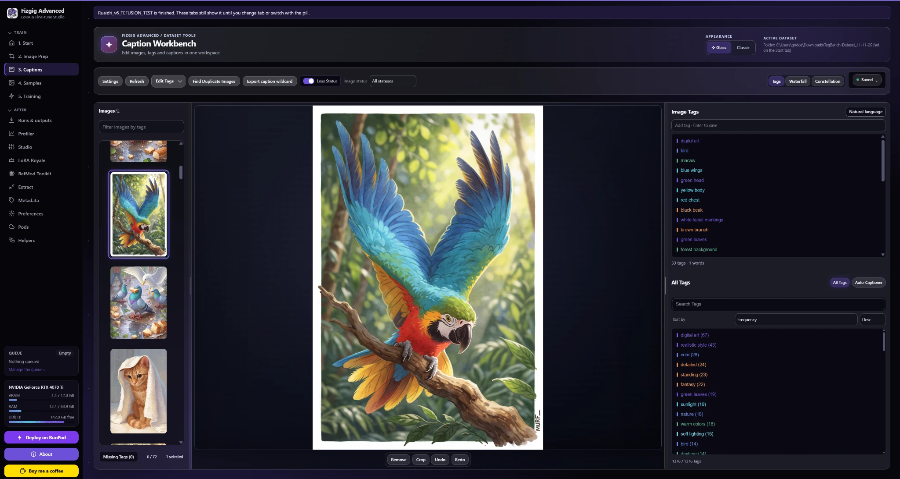
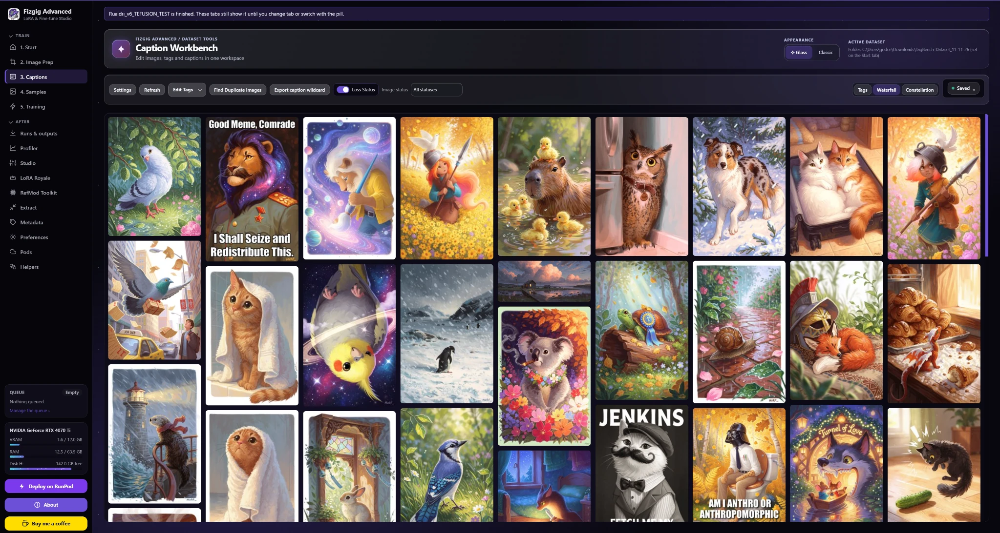
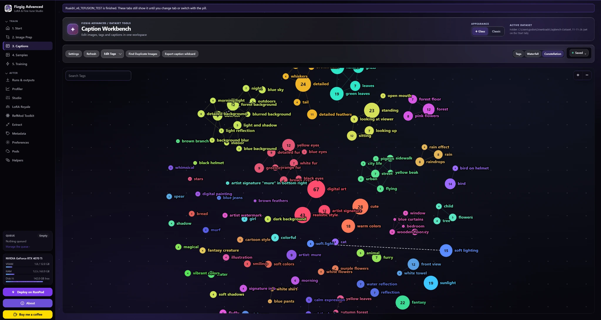
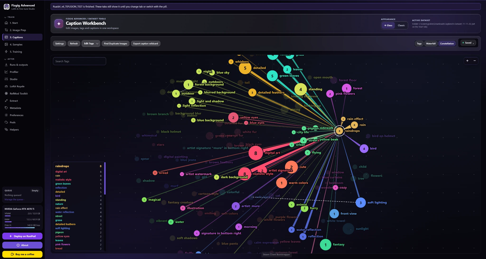

# Fizgig Advanced 1.7 — Caption Workbench features

<!-- Extended release draft on test/caption-workbench; release-readiness notes tracked separately in docs/CAPTION_WORKBENCH_1_7_RELEASE_PREP.md. -->

## The highlights

**Caption Workbench is a whole new way to work with your training pictures.** The Captions tab is now a visual workspace: browse your dataset, edit pictures, work with tags or natural-language captions, find duplicates and see how individual images are learning, all without jumping between separate tools.

**Edit pictures while a LoRA trains, and Fizgig re-caches what changed.** Crop an image, remove an object with local LaMa, change a caption or update a supported mask; at the next epoch boundary the trainer can re-encode the changed image or text instead of starting the whole cache over. Eligible new pictures can join an active run too. Unsupported changes are flagged rather than quietly used with stale caches. *Full live GPU acceptance is still pending.*

**Pick your verification and sample pictures where you're already looking at them.** Right-click images in Tags or Waterfall to add or remove them from Validation Images or Sample Images, including multiple selections. Sample picks can use the picture's own caption as the preview prompt, while leaving your manually written prompts alone.

**See which images are learning and which are stuck.** With Loss Status on, a second colored outline identifies images the training loss watcher considers **Stuck**, **Learning**, **Easy**, **Fully mined** or in another monitored state. Sort or filter by those results to find pictures worth revisiting. Selection highlighting stays separate.

**Tags finally have a visual language of their own.** Related tags receive consistent colors across Image Tags, All Tags and Constellation. Right-click any tag to choose a preset or custom color, or return it to Auto. Edit comma-separated tags quickly, switch to a natural-language caption field, and keep prose intact when sorting or changing tags.

**Explore your dataset as pictures or as relationships.** **Waterfall** lays the images out in a full-width gallery, preserving their different shapes. **Constellation** turns tag frequencies and co-occurrences into a colorful interactive map; click a tag to reveal its closest relationships. Selections carry back into the Tags editor.

**Find near-duplicates before they waste training effort.** Compare likely copies, choose one or several to keep, preview copying useful tags from the others, and remove only the pictures you explicitly choose. Removed images can be restored, and reviewed pictures are protected.

**Experimental model blending now supports more model families.** Alongside live MiniMax H3 Image + H3 Video Frankenstein blending, Studio has a separate block-based **Base checkpoint mixer** for compatible **MOSS-Image, Anima, Krea 2 and SDXL / Illustrious** checkpoints. Choose how much of each block comes from the donor and export a new standalone model without loading either input on the GPU. Same-family checkpoints only; this is experimental, and the CPU mixer does not provide live renders.

**New training and Studio tools.** Krea 2 adds **Text-fusion calibration** and **Text fusion only** training, alongside improvements to Global replay. Optional **mid-epoch best-loss checkpoints**, clearer step counts and faster compatible Studio LoRA switching round out the release.

Read on for a closer look at the tools, screenshots, fixes, and upstream contributions.

## Screenshot gallery — Caption Workbench

Here are the three views of Caption Workbench, plus an example of selecting a tag in Constellation to see its connections.

### Tags — image and caption editor

**Tags:** Browse images on the left, edit the selected picture in the center, and manage its tags or caption on the right.

### Waterfall — image-first dataset exploration

**Waterfall:** Browse the whole dataset in a gallery that keeps each picture's aspect ratio.

### Constellation — tag frequency and co-occurrence

**Constellation:** Explore caption tags by frequency, color group, and their connections.

### Constellation — focused tag relationships

**Tag focus:** Selecting **raindrops** highlights related tags and their links while dimming the rest of the map.

## New — Caption Workbench

The Captions tab is now a visual workspace for preparing, tagging, editing and exploring your training images.

### Edit a training image — the cache follows your changes

**Crop, repair or remove unwanted objects without leaving Caption Workbench.** Select an image, use the streamlined **Crop** or **Remove** tools underneath the large preview, and Undo/Redo applied edits. The existing Fizgig **local LaMa** system does the object removal; while training occupies the GPU, the editor can use the CPU. The Image Prep watermark editor remains available separately in its floating glass overlay.

More importantly, **the training dataset is live**. For supported images and caption formats, committed edits are detected and the appropriate **VAE latent or text-encoder cache is refreshed at the next epoch boundary**. Edited masks and supported paired/control references also participate in the refresh. Re-encodes use atomic replacement and guard against the trainer consuming a stale cache after a failed, interrupted or superseded write. A removal takes effect through the live dataset update path instead of requiring the user to rebuild the whole cache manually.

**Add images during a run** where the existing training bucket supports their shape: new eligible stills can be encoded and admitted to a rotating pool while retaining the original number of optimizer steps. New aspect-ratio buckets, unsupported media/layout changes and unsafe updates are reported as needing attention or a restart rather than silently trained with old data. 

Implementation history includes [live still-image admission](https://github.com/Murf-Code/Fizgig-Advanced/commit/4885af56), [mask refresh](https://github.com/Murf-Code/Fizgig-Advanced/commit/7e8e3a3b), and [atomic cache protection](https://github.com/Murf-Code/Fizgig-Advanced/commit/b3cbf33d).

### Choose Validation Images and Sample Images right from your pictures

**Right-click a picture in Tags or Waterfall** to add it to, or remove it from, **Validation Images** or **Sample Images**. Select several pictures to manage them together; the menu reflects whether the current selection is already included. No trip back to Training or Samples settings is necessary, and the same existing training settings are updated rather than creating another list.

For Sample Images, Workbench **uses that picture's caption as the initial preview prompt** and pairs it with the selected training image. Captions that are empty are skipped with feedback. Removing a Workbench-created sample pairing does **not** erase unrelated manual prompts or a prompt the user has since edited. Detail crops are intentionally excluded from these image-pick actions.

See [training-image context actions](https://github.com/Murf-Code/Fizgig-Advanced/commit/7c4ed76b) and `caption_studio_training_picks.js`.

### Training intelligence, visible on every image

Turn on **Loss Status** to see a **second, color-coded outline** around a dataset thumbnail in Tags and Waterfall. The original selection ring stays visible, so selecting an image and seeing its learning state are independent.

Statuses come from Fizgig's **actual per-image loss watcher**, not from guessing that a low raw loss equals an easy image. The UI can distinguish **Stuck**, **Suspect**, **Watching**, **Learning**, **Easy**, **Fully mined**, **Warming up** and **Excluded**. Filter images by these verdicts, or sort by higher/lower relative loss, to review the pictures most in need of attention. An actively tracked training run automatically enables its loss colors unless the user opted out for that run; an old finished run does not silently force the option on.

This turns training-loss analysis into a **visual dataset-review workflow** instead of making users hunt through separate graphs. See [learning-status rings](https://github.com/Murf-Code/Fizgig-Advanced/commit/22402621) and [image-status filter](https://github.com/Murf-Code/Fizgig-Advanced/commit/bc34024a).

### Tag colors that mean something — and stay consistent

Tags are not assigned random unrelated colors in each view. **Constellation groups and tag relationships inform a shared automatic palette**, reused in Image Tags, All Tags and Constellation so the same tag keeps the same color across the workspace.

**Right-click a tag** to override its color: pick from eight prepared swatches, choose a custom color, or **reset to Auto color**. Saved manual choices take priority over the learned palette; existing dataset category assignments continue to be read. The color preferences are **remembered locally for that dataset in the browser**. 

See [shared colors and context palette](https://github.com/Murf-Code/Fizgig-Advanced/commit/f6737e21), [shared Constellation palette](https://github.com/Murf-Code/Fizgig-Advanced/commit/909bb941).

### Tags and natural-language captions, without mangling either

Workbench understands the difference between **comma-separated tag captions** and **natural-language prose**. Use Image Tags for quick select/edit of individual tags, with autocomplete; choose the **Natural language** caption mode to work in an expanding text field instead of the tag list. Switching back to **All Tags** brings back the searchable tag index.

With a mixed caption, the **first line may contain tags and subsequent lines may contain prose**. Tag sorting, deduplication and bulk actions preserve those prose lines rather than rewriting the whole caption as tags. The format detector favors prose when ambiguous, protecting ordinary sentences from accidental tag operations.

**Edits save automatically**; selected tag edits are sent promptly, while draft/history state and serialized saves protect against rapid repeated changes. Double-click an existing tag to rename it; leaving its replacement blank restores the original. Use Enter or a clickable autocomplete suggestion to add a tag, and select multiple tags for context actions, batch operations, drag/reorder or deletion. Session undo/redo covers supported committed edits; the local brush canvas has its own uncommitted stroke history.

See [format-safe tag operations](https://github.com/Murf-Code/Fizgig-Advanced/commit/2a828556), [natural-language editor](https://github.com/Murf-Code/Fizgig-Advanced/commit/f6737e21), and [autosave](https://github.com/Murf-Code/Fizgig-Advanced/commit/8c2e197c).

### See your dataset three different ways

- **Tags:** A focused full-height image, narrow scrollable thumbnail rail, two independently scrollable lists for Image Tags and All Tags, right-click actions, search-as-you-type, and in-place editing. Use Ctrl/Cmd and Shift to select multiple images, arrow keys to navigate, and shortcuts to focus searches or invoke common operations.
- **Waterfall:** A **full-width masonry gallery of the actual images**, not merely a tag-frequency bar chart. Thumbnail proportions are preserved, and selecting a picture carries the same active selection back into Tags; double-click to open the chosen image there. Context actions, including Validation and Sample Image picks, work here too.
- **Constellation:** A large interactive **tag co-occurrence map** with frequency-sized colored orbs, linked relationships, clusters, search, pan and zoom. Select a tag to spotlight related tags and their connection strengths while unrelated nodes dim. The focused view includes a ranked list of related tags. This is especially useful for finding patterns and inconsistent descriptions in a dataset.

The **Glass / Classic** appearance switch, responsive/resizable panels, compact editing toolbar and full-window layouts make these tools feel like one application rather than separate forms.  See [full-size Waterfall and Constellation](https://github.com/Murf-Code/Fizgig-Advanced/commit/072920e2).

### Find near-duplicates without risking your originals

**Find Duplicate Images** scans for exact and visually similar images, using perceptual difference hashes and a color-grid comparison. Adjust the **0–16 similarity tolerance** (larger values are more lenient), inspect side-by-side thumbnails, and choose **one or multiple pictures to keep**.

Optionally **preview a tag merge** from unkept images into every chosen keeper; prose remains intact. Tag merging is separate from any deletion. Only the explicitly chosen **unkept images** are moved to a reversible `removed/` folder, with their related captions/masks and collision safeguards. Reviewed/locked pictures are protected. The scan is CPU-based and does not load a GPU training model. See [duplicate review guide](CAPTION_STUDIO_DUPLICATE_REVIEW.md).

### Faster captioning and safer bulk editing

Use Fizgig's existing local AI captioners on your **selected pictures**, rather than always captioning a whole folder. Choose to **caption missing images only**, **replace selected captions**, or **append an AI caption as another line**; reviewed items are protected and destructive choices require confirmation. Batch Find & Replace includes a preview and undoable commit. Tag queries support **AND / OR / NOT, exact quoted tags and exclusions**; live search and sorting make large tag lists approachable. Export a **caption wildcard** containing the complete caption for each image, instead of a de-duplicated vocabulary list.

Use **Mark Complete / Incomplete** and persistent review locks to protect pictures whose tags are finished. Delete image/tag actions require confirmation, and removed image groups can be restored without blindly overwriting existing files. The workbench avoids unwanted re-captioning of the entire dataset when an explicitly selected target is invalid or empty.

### Training and Studio

- **Krea 2 Text-fusion calibration.** Choose concepts to test or let Fizgig find candidates in your dataset. Manually selected concepts are tested even when they are uncommon in the captions. Fizgig compares them with controls, checks the results on held-out examples, and keeps successful edits. Automatic candidates have their own budget of up to 4% of the training-image count.
- **Krea 2 Global replay — broader training-tool support.** Global replay trains all **28 main transformer blocks** one at a time, using the full model's loss to calculate each block's update. It now works with **masked training, masked prior preservation, Training Maps and PoLoRA**, as well as the optional Selective block check. It still requires a **batch-one standard Krea 2 LoRA**; other model families, LoKR, full fine-tunes and slider training are not part of this method. **Standard** remains available, while **Text fusion only** separately trains Krea 2's four text-fusion blocks.
- **Optional rolling best LoRA checkpoint** can capture a promising low-loss point **mid-epoch**, not just at the ordinary save interval. It supports training-loss or fixed validation-loss selection, smoothing/cooldown safeguards, and resume bookkeeping. The manual **Save Now** action and epoch saves still exist.
- **Clearer training feedback:** real epoch steps remaining for Global replay and resumed runs, plus more useful Pause, Stop, Save Now and run-output states.
- **Smarter resume and caching:** skip demonstrably clean text/VAE cache stages; re-encode only changed images or captions; retain compatible caches and respect explicit cache policy where necessary. Cache validity includes fine-grained file timestamps, encoder provenance and safe fallbacks for complex datasets.
- **Studio improvements.** Switch compatible primary LoRAs without reloading the model, save render settings in PNG metadata, use Studio in multiple tabs more safely, and set separate image-reference size and aspect options.

### Experimental Frankenstein and block-based base-model mixing

**MiniMax H3 Image + H3 Video Frankenstein** blends the two compatible H3 variants live in Studio: change block-level blend sliders, compare Baseline and Tweaked renders, try motion presets and save the blend as a **new H3 Image base checkpoint**. It uses H3-specific mixing and block-streaming logic. The 12 GB GPU path is experimental; the upstream documented range starts at 16 GB.

**Base checkpoint mixer adds four other model families:** **MOSS-Image**, **Anima**, **Krea 2** and **SDXL / Illustrious**. In **Studio → Experimental · Base checkpoint mixer**, select two structurally compatible checkpoints **of the same family**, run Check compatibility, adjust individual block sliders (0 = Base, 1 = Donor), and **Save merged checkpoint**. It exports a standalone `.safetensors` model with mix metadata while preserving unmatched/unselected weights from Base.

This second path is a **CPU-based offline checkpoint export**, not live Frankenstein rendering or LoRA mixing. Tensor interpolation streams bounded chunks (about 8 MiB); it doesn't require GPU VRAM, but does need enough disk space for a full output. Models with incompatible block shapes/layouts or unsupported quantized weights are refused. Mixing across families is not supported. A successful compatibility check does not guarantee a useful blend. Try a few renders before relying on it.

See [experimental model mixing guide](EXPERIMENTAL_MODEL_MIXING.md), [four-family mixer implementation](https://github.com/Murf-Code/Fizgig-Advanced/commit/6b6d4b61cb) and [upstream H3 Frankenstein work](https://github.com/shootthesound/Fizgig/releases/tag/v9.8.3).

### Sidebar navigation and validation graph

**Collapsible TRAIN and AFTER sidebar sections.** Click either heading to fold away that group of tabs and make room for the other one. Each section remembers whether you left it open or closed, and its chevron rotates to show the state. This also works from the keyboard.

**Validation groups are easier to compare.** With two or three Image Validation groups, each group has its own thin line, color, dash pattern and marker. The lines are now **shifted onto the thick dashed average** so differences in their shape stand out without flattening the graph's scale. Hover over a point to see that group's **real, unshifted loss**. The old **Group range** shaded band has been removed; early stopping and Adaptive LR still use the actual average.

### Built for large datasets

Under the hood, Caption Workbench uses **recycled native-scrolling thumbnail rows**, deferred image decoding, bounded preview caches, progressively loaded Waterfall pictures and All Tags rows, **Constellation calculation only when needed**, compiled tag-search predicates, and reduced work from inactive tabs. The Remove brush uses a lightweight overlay, bounded/tiled history and an offscreen painting worker with a safe fallback. These choices aim to keep image navigation and editing responsive without wasting RAM and CPU.

### Two-click Run deletion

In **Runs & Outputs**, **Delete run** now requires two clicks. The first click changes the button to **Confirm** in the same place; click it again within **30 seconds** to delete the run's saved checkpoints, resume states, previews and history entry. If you leave it alone, it resets to **Delete run**. The button keeps the same width, so it does not jump when its label changes. **Your training pictures and captions are never deleted.**

## Fixed
- Prevent incorrect selected-only AI caption operations from silently expanding to caption the whole dataset.
- Roll back failed image/caption/mask file moves and preserve mask subfolder paths; fail closed on corrupted removal journals.
- Preserve review locks through supported legacy caption and duplicate-merge operations.
- Guard against stale cross-folder caption loads, stale Studio browser tabs, and cross-tab destructive actions.
- Protect dataset sync from mask sidecars being treated as training pictures and from superseded Image Prep originals being admitted.
- Correct Undo/Redo busy-state handling and cross-view selected-image handoff.
- Safer Stop and Pause transitions between training stages, with clearer status after saving.
- Reject GGUF/non-safetensors model and captioner inputs early, including bounded safetensors-header checks.
- Handle video-only training datasets without inaccessible remembered masked-training/element-boost settings.
- Improve AMD ROCm MIOpen database-path handling, with an **opt-in** `FIZGIG_MIOPEN=0` convolution workaround.

## From upstream Fizgig

Thanks to **[Peter Neill / @shootthesound](https://github.com/shootthesound)** and the Fizgig contributors. Advanced 1.7 includes selected Studio features, model and image handling improvements, and compatibility fixes from later Fizgig releases.

| Original source | How it relates to Workbench |
| --- | --- |
| [Fizgig upstream](https://github.com/shootthesound/Fizgig) | Studio, MiniMax H3, safety and AMD improvements from the 9.8.x releases. |
| [#388](https://github.com/shootthesound/Fizgig/pull/388) | Captioner safetensors-only guard; adapted with bounded header checks. |
| [#402](https://github.com/shootthesound/Fizgig/pull/402) | Video-only folder/mask training launch check. |
| [#397](https://github.com/shootthesound/Fizgig/pull/397) | Offline-first tokenizer and partial-cache recovery. |
| [#370](https://github.com/shootthesound/Fizgig/pull/370) | Resume and cache handling when training resolution changes. |
| [#389](https://github.com/shootthesound/Fizgig/pull/389) | AMD MIOpen database path and optional convolution workaround. |
| [#394](https://github.com/shootthesound/Fizgig/pull/394) | Primary-LoRA Studio hot swap; adapted to Advanced's single-worker architecture. |
| [#395](https://github.com/shootthesound/Fizgig/pull/395) | Multi-tab Studio ownership/isolation. |
| [#398](https://github.com/shootthesound/Fizgig/pull/398) and [#399](https://github.com/shootthesound/Fizgig/pull/399) by [@spaghettified26](https://github.com/spaghettified26) | **Integrated.** Pillow 13.0.0 update for PNG EXIF safety (#398) and faster PNG dimension/header reading without full image decoding in dataset listings (#399), with regression tests and source credits. See [Pillow commit](https://github.com/Murf-Code/Fizgig-Advanced/commit/aaa1062363) and [PNG optimization](https://github.com/Murf-Code/Fizgig-Advanced/commit/72759c1aa2). |
| **TagBench / TagGUI** | Inspiration for caption editing, Waterfall, Constellation and duplicate review. These workflows use Fizgig's own dataset and image editing systems, including local LaMa. |
