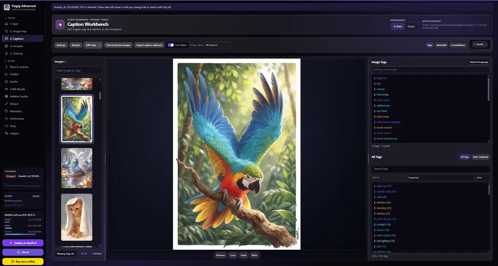
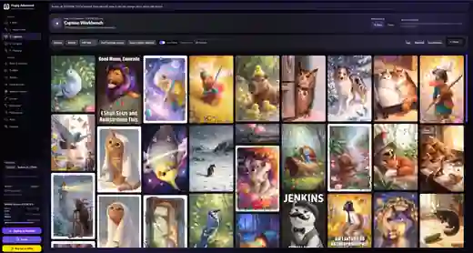
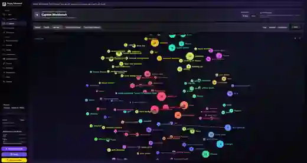
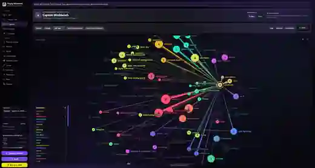

# Fizgig Advanced 1.7

Fizgig Advanced 1.7 is the **Caption Workbench** release. The Captions tab is now an image-first workspace for editing pictures, writing tags or natural-language captions, finding duplicates, exploring relationships between tags, and seeing which training images are **Stuck**, **Learning** or **Easy**. Right-click a picture to use it for **Image Validation** or **Sample Previews**. Edit a picture or caption during training and, for supported datasets, Fizgig re-encodes what changed at the next epoch rather than rebuilding the whole cache. There is also a new **Krea 2 Text-fusion calibration** workflow, optional mid-epoch best-loss saves, improved Studio LoRA switching, and experimental block-by-block base-model mixing for **H3 Image + Video, MOSS-Image, Anima, Krea 2 and SDXL / Illustrious**.

## Heads up

- **Release candidate draft, not a published release.** This is the 1.7 release-notes working copy from `test/caption-workbench`; the whole-branch audit and live GPU acceptance are not complete.
- **Experimental model blending:** H3's live Frankenstein mode and the separate CPU checkpoint mixer are opt-in. Same-family checkpoint compatibility is checked, but a compatible blend is not a guarantee of image quality.
- **Live editing:** images/captions and supported masks/references can be re-cached between epochs. Unsupported video/audio/layout changes or entirely new bucket shapes can require a restart; the UI reports them instead of using stale training data.
- **Krea 2:** the new Text-fusion calibration stays. The experimental **Training Text Enhancer** port was intentionally reverted and is **not part of 1.7**.
- **Upstream:** Advanced 1.6 was based on Fizgig v9.7.6; 1.7 selectively integrates relevant later 9.8.x fixes and Studio features, not the entirety of upstream's separate queue design. Run the normal updater when 1.7 is published, after its final dependency requirements are confirmed.

## Caption Workbench in pictures

Four screenshots show **Tags**, **Waterfall**, the **Constellation** overview, and its **focused relationships** view. The images below are embedded directly from this repository; the original full-resolution PNGs remain in the release screenshot package.

## New

### Edit a training image — the cache follows your changes

**Crop, repair or remove unwanted objects without leaving Caption Workbench.** Select an image, use the streamlined **Crop** or **Remove** tools underneath the large preview, and Undo/Redo applied edits. The existing Fizgig **local LaMa** system does the object removal; while training occupies the GPU, the editor can use the CPU. The Image Prep watermark editor remains available separately in its floating glass overlay.

More importantly, **the training dataset is live**. For supported images and caption formats, committed edits are detected and the appropriate **VAE latent or text-encoder cache is refreshed at the next epoch boundary**. Edited masks and supported paired/control references also participate in the refresh. Re-encodes use atomic replacement and guard against the trainer consuming a stale cache after a failed, interrupted or superseded write. A removal takes effect through the live dataset update path instead of requiring the user to rebuild the whole cache manually.

**Add images during a run** where the existing training bucket supports their shape: new eligible stills can be encoded and admitted to a rotating pool while retaining the original number of optimizer steps. New aspect-ratio buckets, unsupported media/layout changes and unsafe updates are reported as needing attention or a restart rather than silently trained with old data. Live image/caption/mask/paired-reference handling has automated tests but **still requires end-to-end real-GPU acceptance before release sign-off**.

Implementation history includes [live still-image admission](https://github.com/Murf-Code/Fizgig-Advanced/commit/4885af56), [mask refresh](https://github.com/Murf-Code/Fizgig-Advanced/commit/7e8e3a3b), and [atomic cache protection](https://github.com/Murf-Code/Fizgig-Advanced/commit/b3cbf33d).

### Choose Validation Images and Sample Images right from your pictures

**Right-click a picture in Tags or Waterfall** to add it to, or remove it from, **Validation Images** or **Sample Images**. Select several pictures to manage them together; the menu reflects whether the current selection is already included. No trip back to Training or Samples settings is necessary, and the same existing training settings are updated rather than creating another list.

For Sample Images, Workbench **uses that picture's caption as the initial preview prompt** and pairs it with the selected training image. Captions that are empty are skipped with feedback. Removing a Workbench-created sample pairing does **not** erase unrelated manual prompts or a prompt the user has since edited. Detail crops are intentionally excluded from these image-pick actions.

See [training-image context actions](https://github.com/Murf-Code/Fizgig-Advanced/commit/7c4ed76b) and `caption_studio_training_picks.js`.

### Training intelligence, visible on every image

Turn on **Loss Status** to see a **second, color-coded outline** around a dataset thumbnail in Tags and Waterfall. The original selection ring stays visible, so selecting an image and seeing its learning state are independent.

Statuses come from Fizgig's **actual per-image loss watcher**, not from guessing that a low raw loss equals an easy image. The UI can distinguish **Stuck**, **Suspect**, **Watching**, **Learning**, **Easy**, **Fully mined**, **Warming up** and **Excluded**. Filter images by these verdicts, or sort by higher/lower relative loss, to review the pictures most in need of attention. An actively tracked training run automatically enables its loss colors unless the user opted out for that run; an old finished run does not silently force the option on.

This turns training-loss analysis into a **visual dataset-review workflow** instead of making users hunt through separate graphs. See [learning-status rings](https://github.com/Murf-Code/Fizgig-Advanced/commit/22402621) and [image-status filter](https://github.com/Murf-Code/Fizgig-Advanced/commit/bc34024a).

### Tag colors that mean something — and stay consistent

Tags are not assigned random unrelated colors in each view. **Constellation groups and tag relationships inform a shared automatic palette**, reused in Image Tags, All Tags and Constellation so the same tag keeps the same color across the workspace.

**Right-click a tag** to override its color: pick from eight prepared swatches, choose a custom color, or **reset to Auto color**. Saved manual choices take priority over the learned palette; existing dataset category assignments continue to be read. The color preferences are **remembered locally for that dataset in the browser**. The current UI no longer needs the old bulky color-settings panel.

See [shared colors and context palette](https://github.com/Murf-Code/Fizgig-Advanced/commit/f6737e21), [shared Constellation palette](https://github.com/Murf-Code/Fizgig-Advanced/commit/909bb941).

### Tags and natural-language captions, without mangling either

Workbench understands the difference between **comma-separated tag captions** and **natural-language prose**. Use Image Tags for quick select/edit of individual tags, with autocomplete; choose the **Natural language** caption mode to work in an expanding text field instead of the tag list. Switching back to **All Tags** brings back the searchable tag index.

With a mixed caption, the **first line may contain tags and subsequent lines may contain prose**. Tag sorting, deduplication and bulk actions preserve those prose lines rather than rewriting the whole caption as tags. The format detector favors prose when ambiguous, protecting ordinary sentences from accidental tag operations.

**Edits save automatically**; selected tag edits are sent promptly, while draft/history state and serialized saves protect against rapid repeated changes. Double-click an existing tag to rename it; leaving its replacement blank restores the original. Use Enter or a clickable autocomplete suggestion to add a tag, and select multiple tags for context actions, batch operations, drag/reorder or deletion. Session undo/redo covers supported committed edits; the local brush canvas has its own uncommitted stroke history.

See [format-safe tag operations](https://github.com/Murf-Code/Fizgig-Advanced/commit/2a828556), [natural-language editor](https://github.com/Murf-Code/Fizgig-Advanced/commit/f6737e21), and [autosave](https://github.com/Murf-Code/Fizgig-Advanced/commit/8c2e197c).

### See your dataset three different ways

- **Tags:** A focused full-height image, narrow scrollable thumbnail rail, two independently scrollable lists for Image Tags and All Tags, right-click actions, search-as-you-type, and in-place editing. Use Ctrl/Cmd and Shift to select multiple images, arrow keys to navigate, and shortcuts to focus searches or invoke common operations.
- **Waterfall:** A **full-width masonry gallery of the actual images**, not merely a tag-frequency bar chart. Thumbnail proportions are preserved, and selecting a picture carries the same active selection back into Tags; double-click to open the chosen image there. Context actions, including Validation and Sample Image picks, work here too.
- **Constellation:** A large interactive **tag co-occurrence map** with frequency-sized colored orbs, linked relationships, clusters, search, pan and zoom. Select a tag to spotlight related tags and their connection strengths while unrelated nodes dim. The focused view includes a ranked list of related tags. This is especially useful for finding patterns and inconsistent descriptions in a dataset.

The **Glass / Classic** appearance switch, responsive/resizable panels, compact editing toolbar and full-window layouts make these tools feel like one application rather than separate forms. The four supplied screenshots belong immediately above these highlights. See [full-size Waterfall and Constellation](https://github.com/Murf-Code/Fizgig-Advanced/commit/072920e2).

### Find near-duplicates without risking your originals

**Find Duplicate Images** scans for exact and visually similar images, using perceptual difference hashes and a color-grid comparison. Adjust the **0–16 similarity tolerance** (larger values are more lenient), inspect side-by-side thumbnails, and choose **one or multiple pictures to keep**.

Optionally **preview a tag merge** from unkept images into every chosen keeper; prose remains intact. Tag merging is separate from any deletion. Only the explicitly chosen **unkept images** are moved to a reversible `removed/` folder, with their related captions/masks and collision safeguards. Reviewed/locked pictures are protected. The scan is CPU-based and does not load a GPU training model. See [duplicate review guide](CAPTION_STUDIO_DUPLICATE_REVIEW.md).

### Faster captioning and safer bulk editing

Use Fizgig's existing local AI captioners on your **selected pictures**, rather than always captioning a whole folder. Choose to **caption missing images only**, **replace selected captions**, or **append an AI caption as another line**; reviewed items are protected and destructive choices require confirmation. Batch Find & Replace includes a preview and undoable commit. Tag queries support **AND / OR / NOT, exact quoted tags and exclusions**; live search and sorting make large tag lists approachable. Export a **caption wildcard** containing the complete caption for each image, instead of a de-duplicated vocabulary list.

Use **Mark Complete / Incomplete** and persistent review locks to protect pictures whose tags are finished. Delete image/tag actions require confirmation, and removed image groups can be restored without blindly overwriting existing files. The workbench avoids unwanted re-captioning of the entire dataset when an explicitly selected target is invalid or empty.

### Training workflow improvements worth showing users

- **Krea 2 Text-fusion calibration remains included.** Manually requested concepts get directly tested against controls, with an additional automatic target budget of up to 4% of training-image count; measured suppression and held-out verification determine whether an edit is retained. This is **not** the experimental Training Text Enhancer, which was deliberately reverted.
- **Text fusion only** is a separate Krea 2 training choice for the text-fusion blocks, alongside **Standard** and **Global replay** training with optional selective block checks. Global replay's compatibility work includes PoLoRA, training masks and Training Maps where supported.
- **Optional rolling best LoRA checkpoint** can capture a promising low-loss point **mid-epoch**, not just at the ordinary save interval. It supports training-loss or fixed validation-loss selection, smoothing/cooldown safeguards, and resume bookkeeping. The manual **Save Now** action and epoch saves still exist.
- **Clearer training feedback:** real epoch steps remaining for Global replay/resume, separate validation groups on the loss graph, and more useful pause/stop, Save Now and run-output states.
- **Smarter resume and caching:** skip demonstrably clean text/VAE cache stages; re-encode only changed images or captions; retain compatible caches and respect explicit cache policy where necessary. Cache validity includes fine-grained file timestamps, encoder provenance and safe fallbacks for complex datasets.
- **Studio upgrades:** upstream-adapted primary-LoRA quick switching with rollback; render-specific PNG setup metadata; per-browser-tab ownership protections; edit-reference aspect/Reference MP control; and optional MiniMax H3 Image speed boost.

### Experimental Frankenstein and block-based base-model mixing

**MiniMax H3 Image + H3 Video Frankenstein** blends the two compatible H3 variants live in Studio: change block-level blend sliders, compare Baseline and Tweaked renders, try motion presets and save the blend as a **new H3 Image base checkpoint**. It uses H3-specific mixing and block-streaming logic. The experimental 12 GB GPU plan is **not hardware-validated**; upstream's documented tested path starts at 16 GB.

**Base checkpoint mixer adds four other model families:** **MOSS-Image**, **Anima**, **Krea 2** and **SDXL / Illustrious**. In **Studio → Experimental · Base checkpoint mixer**, select two structurally compatible checkpoints **of the same family**, run Check compatibility, adjust individual block sliders (0 = Base, 1 = Donor), and **Save merged checkpoint**. It exports a standalone `.safetensors` model with mix metadata while preserving unmatched/unselected weights from Base.

This second path is a **CPU-based offline checkpoint export**, not live Frankenstein rendering or LoRA mixing. Tensor interpolation streams bounded chunks (about 8 MiB); it doesn't require GPU VRAM, but does need enough disk space for a full output. Models with incompatible block shapes/layouts or unsupported quantized weights are refused. Mixing across families is not supported. A successful compatibility check does not guarantee attractive output; real checkpoint/output testing is still outstanding.

See [experimental model mixing guide](EXPERIMENTAL_MODEL_MIXING.md), [four-family mixer implementation](https://github.com/Murf-Code/Fizgig-Advanced/commit/6b6d4b61cb) and [upstream H3 Frankenstein work](https://github.com/shootthesound/Fizgig/releases/tag/v9.8.3).

### Built for large datasets (performance and resource use)

Under the hood, Caption Workbench uses **recycled native-scrolling thumbnail rows**, deferred image decoding, bounded preview caches, progressively loaded Waterfall pictures and All Tags rows, **Constellation calculation only when needed**, compiled tag-search predicates, and reduced work from inactive tabs. The Remove brush uses a lightweight overlay, bounded/tiled history and an offscreen painting worker with a safe fallback. These choices aim to keep image navigation and editing responsive without wasting RAM and CPU.

**Release-note framing:** because this is the first public Workbench experience, describe these as *large-dataset design benefits*, not claims of a speedup over a Workbench version users never used. Benchmark numbers belong in technical notes after reproducible hardware measurements, not the opening feature story.

## Changed

- **Caption Workbench replaces the old captioning layout.** The selected picture gets the main stage; the thumbnail browser and tags panels resize to fit the window. Common actions use compact menus, shortcuts, or right-click instead of duplicate buttons.
- **Safer, more informative editing.** Edit states, auto-save completion, pending writes, reviews and epoch re-cache status are easier to see. Image Prep's floating glass editor remains a separate tool for watermark/mask work.
- **Training run controls and progress.** Pause/Stop/Save Now and run deletion use clearer state and confirmation behavior; step counters follow real in-epoch progress, including Global replay and resumed runs.
- **GPU-accelerated desktop view by default.** After browser/WebView2 testing, the superseded native Qt image renderer was removed rather than maintaining two paths.
- **Built for large datasets.** Workbench uses recycled scrolling thumbnail rows, bounded decoding/preview memory, deferred Waterfall and Constellation work, and reduced background CPU activity. These are usability improvements, not advertised before/after speedups against an unreleased Workbench.

## Fixed
- Prevent incorrect selected-only AI caption operations from silently expanding to caption the whole dataset.
- Roll back failed image/caption/mask file moves and preserve mask subfolder paths; fail closed on corrupted removal journals.
- Preserve review locks through supported legacy caption and duplicate-merge operations.
- Guard against stale cross-folder caption loads, stale Studio browser tabs, and cross-tab destructive actions.
- Protect dataset sync from mask sidecars being treated as training pictures and from superseded Image Prep originals being admitted.
- Correct Undo/Redo busy-state handling and cross-view selected-image handoff.
- Keep requested stop behavior across subprocess boundaries and training-stage handoffs; preserve Pause semantics. Live interruption/resume validation remains open.
- Reject GGUF/non-safetensors model and captioner inputs early, including bounded safetensors-header checks.
- Handle video-only training datasets without inaccessible remembered masked-training/element-boost settings.
- Improve AMD ROCm MIOpen database path fallbacks and an **opt-in** `FIZGIG_MIOPEN=0` workaround. No AMD GPU smoke-test claim.

## From upstream Fizgig

Thanks to **[Peter Neill / @shootthesound](https://github.com/shootthesound)** and the upstream Fizgig contributors. Advanced 1.6 was based on upstream **v9.7.6**; this 1.7 branch **selectively adapts** later upstream 9.8.x work. It does **not** claim a blanket merge of every upstream feature or queue architecture.

- **Faster primary-LoRA switching in Studio** — adapted from [#394](https://github.com/shootthesound/Fizgig/pull/394), with safe rollback and model-session protection.
- **Studio browser-tab isolation and render metadata** — adapted from upstream [#395](https://github.com/shootthesound/Fizgig/pull/395); prevents stale tabs from controlling the wrong model.
- **MiniMax H3 Image Frankenstein experiment** — adapted from [upstream v9.8.3](https://github.com/shootthesound/Fizgig/releases/tag/v9.8.3). Advanced adds its own separate CPU checkpoint mixer for MOSS-Image, Anima, Krea 2 and SDXL / Illustrious.
- **Pillow and PNG image safety/performance** — [#398](https://github.com/shootthesound/Fizgig/pull/398) and [#399](https://github.com/shootthesound/Fizgig/pull/399), thanks [@spaghettified26](https://github.com/spaghettified26); updated Pillow and avoids full PNG decode for dimension scans.
- **Model loading and training safety** — [#388](https://github.com/shootthesound/Fizgig/pull/388) captioner model guards, [#397](https://github.com/shootthesound/Fizgig/pull/397) offline-first tokenizer caching, [#402](https://github.com/shootthesound/Fizgig/pull/402) video-only dataset mask setup, and upstream safetensors-header protections.
- **AMD MIOpen compatibility** — upstream [#389](https://github.com/shootthesound/Fizgig/issues/389), including the Windows MIOpen database path and an opt-in convolution workaround. Credit upstream reports from @dkspwndj and @scryptio as applicable.
- **Krea 2 memory handling** — upstream [#380](https://github.com/shootthesound/Fizgig/issues/380), releasing the text encoder without an unnecessary RAM copy.
- **Training cache resume improvements** — upstream [#370](https://github.com/shootthesound/Fizgig/pull/370); overlapping functionality was already present in Advanced and wasn't blindly copied a second time.

**TagBench / TagGUI credit:** thanks to TagGUI and the user-supplied TagBench 1.2 reference for the visual tagging, Waterfall, Constellation and duplicate-review inspiration. Fizgig Advanced uses its own training, image, caption, and local LaMa services; this isn't a wholesale import of another app. Confirm the canonical upstream TagGUI URL and author before final publication.

## To update

When 1.7 is published, use Fizgig Advanced's normal updater. The final release must include verified dependency requirements and a completed current-head CI / GPU sign-off. Until then, this file is a **draft**, not instructions to switch a production install.

## Internal release checklist (remove before publication)

- Verify current-head complete CI, including Text-fusion calibration, image/cache/mask refresh, save/pause/resume, Stage handoff and Studio metadata.
- Test live CUDA training across edit → next epoch, new images, masks, removal and restore; perform AMD/ROCm smoke tests.
- Confirm the 9.8.x upstream PR/issue attributions and include the correct TagGUI/TagBench project URL.
- Commit all four screenshot images to `docs/assets/screenshots/` and activate the Markdown embeds.
- Review all 1.7 features and determine whether any experimental claims should be omitted from the final published notes.

For the full audit and per-commit references see [the extended Workbench draft](RELEASE_NOTES_WORKBENCH_DRAFT_2026-11-23.md), [upstream integration plan](UPSTREAM_9_8_INTEGRATION_PLAN.md), and [experimental model mixing guide](EXPERIMENTAL_MODEL_MIXING.md).
